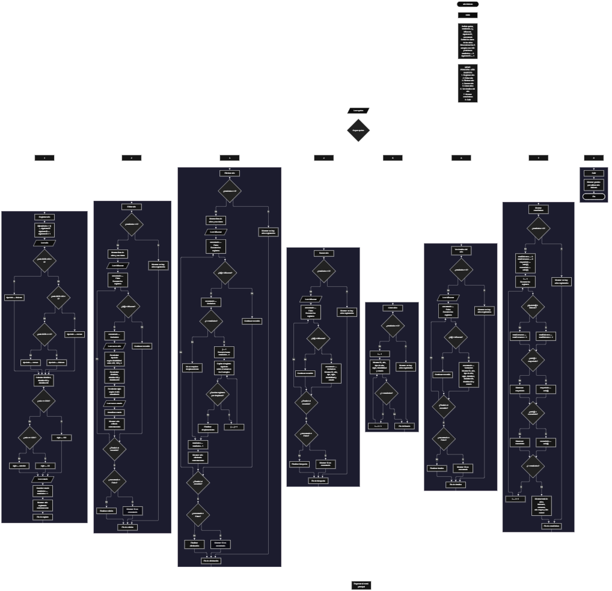

 

Este proyecto, llamado <b>año bisiesto</b>, fue desarrollado en <b>pseint</b> como un ejercicio práctico para fortalecer la lógica de programación mediante la creación de un sistema de gestión y clasificación de años desde la consola. El programa cuenta con un menú principal de ocho opciones que permite <b>registrar, editar, eliminar, buscar, listar, consultar detalles y mostrar estadísticas</b> de los años registrados. Cada registro almacena información como el año, su clasificación como bisiesto o común, el siglo al que pertenece, su divisibilidad entre 4, 100 y 400, y su estado. Para organizar esta información, se utilizan ocho arreglos paralelos con una capacidad declarada de <b>100 posiciones</b>. Durante su desarrollo se aplicaron conceptos fundamentales de programación, como variables, arreglos, estructuras condicionales, ciclos repetitivos, estructuras de selección y operaciones para administrar registros. Además, se implementaron las reglas del calendario gregoriano para determinar si un año es bisiesto y procedimientos para calcular estadísticas generales. Este proyecto permite poner en práctica los conocimientos adquiridos en pseint y sirve como base para desarrollar programas de análisis y gestión de información más avanzados.

<h2 align="center">⚙️ Funcionamiento del menú principal</h2>

### ➕ Registrar año

La opción <b>1) registrar año</b> permite incorporar un nuevo año al sistema. Primero, el programa asigna un identificador consecutivo mediante la variable <b>siguienteID</b> y lo almacena en el arreglo <b>id</b>. Después, solicita el año y determina si es bisiesto o común mediante condiciones que comprueban su divisibilidad entre 400, 100 y 4 utilizando el operador <b>mod</b>. Si el año es divisible entre 400, se clasifica como <b>"bisiesto"</b>; si no es divisible entre 400, pero sí entre 100, se clasifica como <b>"comun"</b>; y, en los demás casos, se comprueba si es divisible entre 4 para establecer su clasificación. A continuación, el programa determina si el año es divisible entre 4, 100 y 400, almacenando los resultados como <b>"si"</b> o <b>"no"</b> en sus respectivos arreglos. También clasifica el siglo como <b>"XXI"</b>, <b>"XX"</b> o <b>"anterior"</b>, según las condiciones implementadas, y solicita el estado del registro. Finalmente, incrementa la variable <b>totalAnios</b> y muestra el mensaje <b>"año registrado correctamente."</b>. El código no comprueba si los arreglos han alcanzado su capacidad máxima antes de registrar otro año.

### ✏️ Editar año

La opción <b>2) editar año</b> permite modificar los datos de un año registrado. Primero, el programa comprueba si la variable <b>totalAnios</b> es igual a <b>0</b>. Si no existen registros, muestra el mensaje <b>"no hay años registrados."</b>. En caso contrario, presenta una lista con el identificador, el año, el tipo de año, el siglo, los indicadores de divisibilidad y el estado de cada registro. Después, solicita el identificador del año que se desea editar y utiliza la variable lógica <b>encontrado</b>, inicializada en <b>falso</b>, para controlar el resultado de la búsqueda. Mediante un ciclo <b>para</b>, recorre los identificadores almacenados en el arreglo <b>id</b>. Cuando encuentra una coincidencia, cambia la variable <b>encontrado</b> a <b>verdadero</b>, solicita el nuevo año y recalcula su clasificación, su siglo y los indicadores de divisibilidad entre 4, 100 y 400. Finalmente, solicita el nuevo estado y muestra el mensaje <b>"año editado correctamente."</b>. Si no encuentra el identificador solicitado, presenta el mensaje <b>"no se encontró un año con ese id."</b>. El ciclo continúa su recorrido después de encontrar una coincidencia.

### 🗑️ Eliminar año

La opción <b>3) eliminar año</b> permite eliminar un registro mediante su identificador. Antes de comenzar, el programa comprueba si existen años registrados. Si el total es cero, muestra el mensaje <b>"no hay años registrados."</b>. En caso contrario, presenta una lista con la información almacenada y solicita el identificador del año que se desea eliminar. Después, inicializa la variable <b>encontrado</b> en <b>falso</b> y recorre los registros mediante un ciclo <b>para</b>. Cuando encuentra el identificador solicitado, cambia la variable a <b>verdadero</b> y comprueba si el registro seleccionado se encuentra antes de la última posición ocupada. Si es así, utiliza un segundo ciclo <b>para</b>, controlado por la variable <b>j</b>, para desplazar los datos posteriores una posición hacia atrás en los ocho arreglos: <b>id, anio, tipoAnio, siglo, divisible4, divisible100, divisible400 y estado</b>. Después, disminuye la variable <b>totalAnios</b> en uno y muestra el mensaje <b>"año eliminado correctamente."</b>. Si no encuentra el identificador, presenta el mensaje <b>"no se encontró un año con ese id."</b>. El código no limpia explícitamente la última posición ocupada después del desplazamiento y continúa el ciclo de búsqueda tras eliminar el registro.

### 🔎 Buscar año

La opción <b>4) buscar año</b> permite localizar un registro mediante su identificador. Primero, el programa comprueba si existen años almacenados. Si no hay registros, muestra el mensaje <b>"no hay años registrados."</b>. Si existen datos, solicita el identificador del año que se desea buscar e inicializa la variable lógica <b>encontrado</b> con el valor <b>falso</b>. A continuación, utiliza un ciclo <b>para</b> para recorrer los identificadores almacenados y compararlos con el valor introducido mediante la condición <b>id[i] = idBuscar</b>. Cuando encuentra una coincidencia, cambia la variable <b>encontrado</b> a <b>verdadero</b>, muestra el mensaje <b>"datos encontrados"</b> y presenta el identificador, el año, su clasificación, el siglo, los indicadores de divisibilidad y el estado. Si finaliza el recorrido sin encontrar coincidencias, muestra el mensaje <b>"no se encontró un año con ese id."</b>. La búsqueda se realiza utilizando el identificador asignado al registro y no el valor numérico del año.

### 📋 Listar años

La opción <b>5) listar años</b> permite visualizar todos los registros almacenados. Antes de mostrar la información, el programa comprueba si la variable <b>totalAnios</b> es igual a cero. Si no existen años registrados, presenta el mensaje <b>"no hay años registrados."</b>. En caso contrario, muestra el mensaje <b>"datos registrados"</b> y utiliza un ciclo <b>para</b> para recorrer los arreglos desde la primera posición hasta el total de registros. Durante el recorrido, presenta el identificador, el año, su clasificación como bisiesto o común, el siglo, la divisibilidad entre 4, 100 y 400, y el estado de cada registro. Esta opción facilita consultar los años almacenados sin tener que buscarlos individualmente.

### 📄 Ver detalles del año

La opción <b>6) ver detalles del año</b> permite consultar la información completa de un registro específico. Primero, el programa comprueba si existen años registrados. Si el total es cero, muestra el mensaje <b>"no hay años registrados."</b>. En caso contrario, solicita el identificador del año que se desea consultar e inicializa la variable lógica <b>encontrado</b> en <b>falso</b>. Después, recorre los registros mediante un ciclo <b>para</b> y compara los identificadores almacenados con el valor introducido. Cuando encuentra una coincidencia, cambia la variable a <b>verdadero</b> y presenta el título <b>"detalles del año"</b>, seguido de cada campo en una línea independiente: identificador, año, tipo de año, siglo, divisibilidad entre 4, divisibilidad entre 100, divisibilidad entre 400 y estado. Si no encuentra el identificador solicitado, muestra el mensaje <b>"no se encontró un año con ese id."</b>. El recorrido continúa después de encontrar una coincidencia.

### 📊 Mostrar estadísticas

La opción <b>7) mostrar estadísticas</b> permite obtener un resumen general de los años registrados. Primero, el programa comprueba si existen registros. Si no hay años almacenados, muestra el mensaje <b>"no hay años registrados."</b>. Si existen datos, inicializa las variables <b>totalBisiestos</b> y <b>totalComunes</b> en cero, y establece el primer año registrado como valor inicial de <b>mayorAnio</b> y <b>menorAnio</b>. Después, utiliza un ciclo <b>para</b> para recorrer los registros. Mediante una estructura condicional, cuenta los años clasificados como <b>"bisiesto"</b> y los clasificados como comunes. Durante el mismo recorrido, compara cada año con los valores de <b>mayorAnio</b> y <b>menorAnio</b> para actualizar el año más grande y el más pequeño. Finalmente, presenta el título <b>"estadística general"</b> y muestra el total de registros, la cantidad de años bisiestos, la cantidad de años comunes, el año mayor y el año menor. Estas estadísticas se calculan a partir de los registros existentes en los arreglos.

### 🚪 Salir del menú principal

La opción <b>8) salir</b> está destinada a finalizar la ejecución del programa y muestra el mensaje <b>"gracias por utilizar año bisiesto."</b>. El menú principal se encuentra dentro de una estructura repetitiva <b>repetir ... hasta que</b>, que permite ejecutar las operaciones disponibles mientras el usuario lo necesite. La condición de salida está definida como <b>hasta que opcion = 8</b>, por lo que, al seleccionar la opción 8, el ciclo termina y finaliza el algoritmo.

<h2 align="center">🧠 Temas aplicados en el proyecto</h2>

### 📦 Variables

En este proyecto se utilizan variables para controlar el menú principal, contabilizar los años registrados, asignar identificadores, recorrer los arreglos, buscar registros y determinar si se encontró el año solicitado. También se utilizan variables para almacenar temporalmente el año que se analiza, su estado y los resultados de las estadísticas. Cada variable cumple una función específica dentro de las operaciones de gestión y clasificación de años.

🔢 **Opcion:** Almacena la opción seleccionada por el usuario en el menú principal.

📊 **TotalAnios:** Almacena la cantidad actual de años registrados.

🔄 **I:** Controla los recorridos de los registros durante las operaciones de edición, eliminación, búsqueda, listado, consulta y estadísticas.

🔁 **J:** Controla el recorrido utilizado para desplazar los datos durante la eliminación de un registro.

🔎 **IdBuscar:** Almacena el identificador introducido por el usuario para localizar un año.

🆔 **SiguienteID:** Genera los identificadores consecutivos asignados a los nuevos registros.

✅ **Encontrado:** Variable lógica que indica si se encontró el identificador solicitado durante las operaciones que requieren una búsqueda.

📅 **Anio:** Almacena el valor numérico del año registrado o modificado.

🗂️ **TipoAnio:** Almacena la clasificación del año como bisiesto o común.

🏛️ **Siglo:** Almacena la clasificación del siglo del año registrado.

➗ **Divisible4, Divisible100 y Divisible400:** Almacenan los resultados de las comprobaciones de divisibilidad entre 4, 100 y 400.

📌 **Estado:** Almacena el estado introducido para cada registro.

📈 **TotalBisiestos y TotalComunes:** Cuentan los años bisiestos y comunes durante el cálculo de estadísticas.

🔝 **MayorAnio y MenorAnio:** Almacenan el año mayor y el año menor encontrados durante el recorrido estadístico.

### 🗃️ Arreglos

En este proyecto se utilizan ocho arreglos paralelos para almacenar los datos correspondientes a cada año. Cada arreglo tiene una capacidad declarada de <b>100 posiciones</b> y utiliza el mismo índice para representar la información de un mismo registro. Por ejemplo, los datos del año almacenado en la posición <b>1</b> se encuentran distribuidos entre <b>id[1], anio[1], tipoAnio[1], siglo[1], divisible4[1], divisible100[1], divisible400[1] y estado[1]</b>. Esta organización permite mantener relacionados los datos al registrar, editar, buscar, listar, consultar o eliminar años.

🆔 **Id[100]:** Almacena los identificadores consecutivos de los registros.

📅 **Anio[100]:** Almacena los valores numéricos de los años registrados.

🗂️ **TipoAnio[100]:** Almacena la clasificación de cada año como bisiesto o común.

🏛️ **Siglo[100]:** Almacena la clasificación del siglo correspondiente a cada año.

➗ **Divisible4[100]:** Almacena si cada año es divisible entre 4.

➗ **Divisible100[100]:** Almacena si cada año es divisible entre 100.

➗ **Divisible400[100]:** Almacena si cada año es divisible entre 400.

📌 **Estado[100]:** Almacena el estado introducido para cada registro.

### 🔀 Estructuras condicionales

En este proyecto se utilizan estructuras <b>si</b> y <b>sino</b> para determinar si un año es bisiesto o común, comprobar su divisibilidad, clasificar su siglo, verificar si existen registros antes de ejecutar determinadas operaciones y comprobar si un identificador coincide con alguno de los almacenados. También se utilizan para actualizar los valores del año mayor y menor durante el cálculo de estadísticas. Estas condiciones permiten que el programa ejecute diferentes instrucciones según los resultados obtenidos.

### 🔄 Estructuras repetitivas

En este proyecto se utilizan los ciclos <b>para</b> y <b>repetir ... hasta que</b>. Los ciclos <b>para</b> permiten recorrer los arreglos para mostrar registros, buscar identificadores, editar información, consultar detalles y calcular estadísticas. Durante la eliminación, se utiliza un ciclo adicional para desplazar los datos posteriores una posición hacia atrás. Por otro lado, el ciclo <b>repetir ... hasta que</b> mantiene activo el menú principal hasta que el usuario selecciona la opción <b>8</b>, que corresponde a la salida del programa.

### 🎯 Estructura según

El programa utiliza la estructura <b>segun opcion hacer</b> para evaluar el valor almacenado en la variable <b>opcion</b> y ejecutar las instrucciones correspondientes. Cada caso representa una operación específica: <b>registrar año, editar año, eliminar año, buscar año, listar años, ver detalles del año, mostrar estadísticas o salir</b>. También se incluye el bloque <b>de otro modo</b>, que muestra el mensaje <b>"opción no válida."</b> cuando el usuario introduce un número que no corresponde a ninguna de las opciones definidas en el menú.

### 🔢 Dimensionamiento de arreglos

El programa utiliza la instrucción <b>dimension</b> para establecer una capacidad de <b>100 posiciones</b> en cada uno de los ocho arreglos. La variable <b>totalAnios</b> controla la cantidad actual de registros y permite que los ciclos recorran las posiciones ocupadas. Sin embargo, el código no comprueba explícitamente que exista espacio disponible antes de registrar un nuevo año. Por ello, aunque los arreglos se dimensionan para 100 posiciones, no se implementa una validación que impida superar esa capacidad.

### 🔄 Reorganización de registros

Cuando se elimina un año, el programa utiliza un ciclo <b>para</b> controlado por la variable <b>j</b> para copiar los datos de las posiciones posteriores sobre la posición del registro eliminado. Este desplazamiento se realiza en los ocho arreglos: <b>id, anio, tipoAnio, siglo, divisible4, divisible100, divisible400 y estado</b>. Después, la variable <b>totalAnios</b> disminuye en uno para reflejar la cantidad actual de registros. El código no limpia explícitamente los valores de la última posición que deja de formar parte de los registros activos, pero las operaciones posteriores recorren el total actualizado.

<h2 align="center">¿Cómo se implementaron las operaciones crud en el proyecto?</h2>

Las operaciones <b>crud</b> se implementaron mediante las opciones del menú principal para administrar los años registrados. La operación <b>crear</b> corresponde a <b>registrar año</b>, donde se introduce un nuevo año y se calculan sus datos derivados; <b>leer</b> se realiza mediante las opciones <b>buscar año, listar años y ver detalles del año</b>; <b>actualizar</b> corresponde a <b>editar año</b>, donde se modifica el año y su estado y se recalculan la clasificación, el siglo y los indicadores de divisibilidad; y <b>eliminar</b> se realiza mediante la opción <b>eliminar año</b>, que desplaza los datos posteriores y actualiza el total de registros. Estas operaciones utilizan variables, arreglos, estructuras condicionales y ciclos para administrar la información almacenada temporalmente durante la ejecución del programa.

<h2 align="center">Diagrama de flujo del proyecto</h2>

<h2 align="center">🛡️ Validaciones del programa</h2>

### 📭 No existen años registrados

Esta comprobación se utiliza en las opciones de <b>editar, eliminar, buscar, listar, ver detalles y mostrar estadísticas</b>. El programa verifica si la variable <b>totalAnios</b> es igual a <b>0</b>. Si no existen registros, muestra el mensaje <b>"no hay años registrados."</b> y no continúa con la operación que requiere información almacenada. De esta manera, evita recorrer los registros cuando el sistema todavía no contiene años registrados.

### ⚠️ Capacidad de los arreglos

Los ocho arreglos se dimensionan con una capacidad de <b>100 posiciones</b>. Sin embargo, el código actual no incluye una condición que compruebe si <b>totalAnios</b> es menor que 100 antes de registrar un nuevo año. Por este motivo, la capacidad está definida en el dimensionamiento, pero no existe una validación explícita que impida intentar registrar más de 100 años.

### ❌ Año no encontrado

Esta comprobación se utiliza en las operaciones de <b>editar, eliminar, buscar y ver detalles del año</b>. El programa inicializa la variable lógica <b>encontrado</b> con el valor <b>falso</b> y recorre el arreglo <b>id</b> para comparar los identificadores almacenados con el valor introducido por el usuario. Cuando encuentra una coincidencia, cambia la variable a <b>verdadero</b> y ejecuta la operación correspondiente. Si termina el recorrido sin encontrar el identificador, muestra el mensaje <b>"no se encontró un año con ese id."</b>.

### 🔢 Identificadores de los años

El programa utiliza la variable <b>siguienteID</b> para asignar un identificador consecutivo a cada nuevo registro. Después de asignarlo, incrementa esta variable en uno. Al eliminar un registro, los identificadores de los registros restantes se desplazan junto con sus demás datos, pero el contador <b>siguienteID</b> no disminuye. Por ello, los nuevos registros continúan recibiendo identificadores posteriores a los que ya se habían asignado.

### 📅 Clasificación de años

El programa determina si un año es bisiesto o común mediante las condiciones de divisibilidad entre <b>400, 100 y 4</b>. Estas reglas permiten clasificar correctamente los años conforme al calendario gregoriano para los valores numéricos procesados. Sin embargo, el código no valida que el usuario introduzca un año positivo ni establece un rango de años permitido. Además, la clasificación del siglo se limita a las etiquetas <b>"XXI"</b>, <b>"XX"</b> y <b>"anterior"</b>, según las condiciones definidas en el algoritmo.

### ⚠️ Opción inválida

La estructura <b>segun</b> incluye el bloque <b>de otro modo</b>, que muestra el mensaje <b>"opción no válida."</b> cuando el usuario introduce un número que no coincide con las ocho opciones del menú. Esta respuesta informa que la selección no corresponde a una operación definida. No obstante, el código no valida expresamente la entrada cuando el usuario introduce un dato que no sea numérico.

<h2 align="center">🎯 Objetivo del proyecto</h2>

El objetivo principal de este proyecto es fortalecer la <b>lógica de programación</b> mediante el desarrollo de un sistema para registrar, clasificar y analizar años en <b>pseint</b>. A través de su construcción se busca aplicar los conocimientos adquiridos sobre variables, arreglos, estructuras condicionales, ciclos repetitivos y estructuras de selección, integrándolos para resolver un problema de manera organizada. Además, el proyecto permite comprender cómo determinar si un año es bisiesto, administrar registros mediante operaciones de creación, consulta, actualización y eliminación, y obtener estadísticas a partir de los datos almacenados. De esta manera, constituye una base práctica para desarrollar programas de análisis y gestión de información más completos utilizando otros lenguajes y tecnologías.

